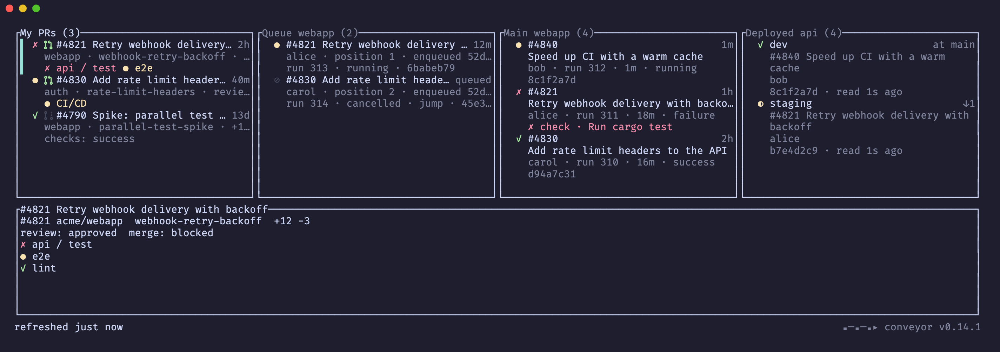

A terminal view of where your changes are: open pull requests, the merge queue, the last
main builds, and what each environment runs. One column per stage, one repo, one screen.



## Installation

```sh
brew install piacsek/tap/conveyor
```

Or take a tarball from the [latest release](https://github.com/piacsek/conveyor/releases/latest)
(macOS arm64 and x86_64, Linux x86_64; each has a `.sha256` and a build-provenance
attestation), or build from source with Rust 1.98+:

```sh
cargo install --git https://github.com/piacsek/conveyor --locked
```

## Dependencies

- [`gh`](https://cli.github.com), logged in (`gh auth login`); Homebrew installs it.
- `git`, to check a pull request out locally.
- `kubectl` with a working context, for the Deployed column only.
- `open`/`pbcopy` on macOS, `xdg-open`/`xclip` on Linux, to open links and copy URLs.
- A [Nerd Font](https://www.nerdfonts.com) as the terminal font, for the pull request icon
  on each card in My PRs (open, in the merge queue, draft). Every other glyph is plain Unicode.

## Usage

```sh
conveyor           # the TUI, for the repository in the current directory
conveyor config    # print the effective configuration
conveyor log       # print the path of the log file
```

| Key | Action |
|---|---|
| `q` | quit |
| `j/k ↓/↑` | move |
| `h/l Tab 1-4` | focus column |
| `p` | open pull request |
| `b` | open build |
| `y/Y` | copy pull request / build URL |
| `d C-d/C-u` | details / scroll them |
| `L` | log of the failed step |
| `S` | manage: merge, update, rerun, status, checkout |
| `z` | zoom the column |
| `Esc` | close details / zoom / mark / filter |
| `/` | filter (Enter keeps, Esc clears) |
| `r/R` | refresh focused / all |
| `?/c` | help / changelog |

Keys act on the focused column; `?` shows what `p` and `b` open there. Narrow terminals
collapse the columns into tabs.

Configuration is `~/.config/conveyor/config.toml` (`$XDG_CONFIG_HOME` and `CONVEYOR_CONFIG`
are honoured). Every key is optional, unknown keys are an error, and these are the defaults:

```toml
[prs]
query = "is:pr is:open archived:false (author:@me OR assignee:@me)"
limit = 20
refresh_secs = 60
merge_method = "squash"
update_method = "merge"

[ui]
min_column_width = 36
details_percent = 40

[[repo]]                      # optional; default is the repository of the current directory
name = "owner/name"
path = "~/projects/name"      # optional; the local clone `S` then `c` checks a pull request out in
main_workflow = "CI/CD"       # workflow name or file, e.g. ci.yml
builds = 10                   # runs shown in the Main builds column
refresh_secs = 30

[[repo.deploy]]               # optional; the Deployed column
system = "api"
refresh_secs = 120

[[repo.deploy.env]]
name = "staging"
fetcher = "kubectl"           # the only fetcher so far
context = "my-staging-context"
namespace = "api"
deployment = "api"
```

## FAQ

**A card shows a box, a `?` in a box, or a blank square before its `#number`.** That is the
pull request icon, a Nerd Font glyph, drawn by a terminal font that lacks it. Set the
terminal's font to a Nerd Font (for example `brew install --cask font-fira-code-nerd-font`,
then pick "FiraCode Nerd Font"), or add one as the terminal's fallback for symbols.
Everything else works without it; only the icon is missing.

## Development

```sh
scripts/gates.sh          # fmt, clippy, tests, tmux e2e tests
scripts/dev-install.sh    # the working tree as ~/.local/bin/conveyor-dev
scripts/ship.sh "message" # gates, dev-install, commit, push, draft PR
```

Guidelines live in `AGENTS.md`.
