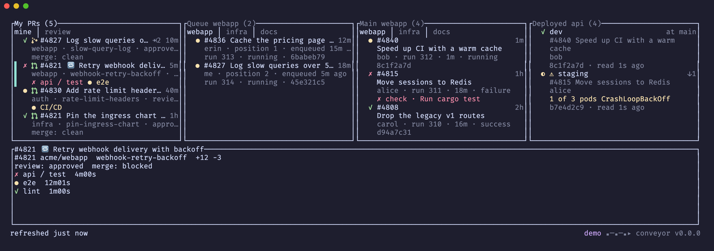

A terminal view of where your changes are: open pull requests, the merge queue, the last
main builds, and what each environment runs. One column per stage, one repo, one screen.



## Installation

```sh
brew install piacsek/tap/conveyor
```

Or take a tarball from the [latest release](https://github.com/piacsek/conveyor/releases/latest)
(macOS arm64 and x86_64, Linux x86_64; each has a `.sha256` and a build-provenance
attestation), or build from source with Rust 1.98+:

```sh
cargo install --git https://github.com/piacsek/conveyor --locked
```

Or with Nix (Linux, Apple silicon), from the `stable` branch, which follows the newest release:

```sh
nix --extra-experimental-features 'nix-command flakes' profile install github:piacsek/conveyor/stable
```

## Dependencies

- [`gh`](https://cli.github.com), logged in (`gh auth login`); Homebrew installs it, the Nix flake
  does not (nor `git` or `kubectl`).
- `git`, to check a pull request out locally.
- `kubectl` with a working context, for the Deployed column only.
- `open`/`pbcopy` on macOS, `xdg-open`/`xclip` on Linux, to open links and copy URLs.
- Optional: a [Nerd Font](https://www.nerdfonts.com) as the terminal font, for GitHub's pull
  request icons on the My PRs cards with `icons = "nerd"`. Without it, conveyor draws plain
  Unicode only.

## Usage

```sh
conveyor           # the TUI, for the repository in the current directory
conveyor config    # print the effective configuration
conveyor log       # print the path of the log file
conveyor --demo    # made-up acme/* data: no gh, kubectl or config needed, nothing is changed
```

| Key | Action |
|---|---|
| `q` | quit |
| `j/k ↓/↑` | move |
| `h/l` | focus column |
| `Tab S-Tab 1-9` | next / previous / nth tab |
| `p` | open pull request |
| `b` | open build |
| `y/Y` | copy pull request / build URL |
| `d C-d/C-u` | details / scroll them |
| `L` | log of the failed step |
| `S` | manage: merge, update, rerun, status, checkout |
| `z` | zoom the column |
| `Esc` | close details / zoom, dismiss a failed action's error, clear the filter |
| `/` | filter (Enter keeps, Esc clears) |
| `r/R` | refresh focused / all |
| `?/c` | help / changelog |

Keys act on the focused column; `?` shows what `p` and `b` open there. Narrow terminals
show one column at a time, named in a bar on top.

Configuration is `~/.config/conveyor/config.toml` (`$XDG_CONFIG_HOME` and `CONVEYOR_CONFIG`
are honoured). Every key is optional, unknown keys and values out of range are an error, and these
are the defaults:

```toml
[prs]
query = "is:pr is:open archived:false (author:@me OR assignee:@me)"
limit = 20                    # 1 to 100
refresh_secs = 60             # 5 or more, like every refresh_secs
merge_method = "squash"
update_method = "merge"
background_tabs = true        # every My PRs tab refreshes on the interval, not only the one shown

# [[prs.tab]]                 # optional, instead of query; one My PRs tab each
# name = "review"
# query = "is:pr is:open review-requested:@me"
# limit = 10                  # optional, 1 to 100; falls back to [prs].limit

[ui]
min_column_width = 36         # 0 to 16383
details_percent = 40          # 1 to 99
icons = "plain"               # or "nerd": GitHub's pull request icons, needs a Nerd Font

[ui.keys]
next_tab = "tab"              # one character, "tab", "shift-tab" or "ctrl-a" to "ctrl-z"
previous_tab = "shift-tab"

[ui.titles]                   # optional; each key renames its column, the repository or system still follows
# prs = "Mine"
# queue = "Queue"
# builds = "Main"
# deployed = "Envs"

[[repo]]                      # optional; default is the repository of the current directory; one tab each in Merge queue and Main builds, switched together (the queue on the first one's refresh_secs); Deployed the one with [[repo.deploy]]
name = "owner/name"
path = "~/projects/name"      # optional; the local clone `S` then `c` checks a pull request out in
main_workflow = "CI/CD"       # workflow name or file, e.g. ci.yml
# branch = "main"             # optional; the branch Main builds reads, default the repository's default branch; repeat a [[repo]] to follow another
# merge_method = "rebase"    # optional; how `S` merges this repository's pull requests, default [prs].merge_method
builds = 10                   # runs shown in the Main builds column, 1 to 100
refresh_secs = 30             # 5 or more

[[repo.deploy]]               # optional, on one [[repo]] at most; the Deployed column
system = "api"
refresh_secs = 120

[[repo.deploy.env]]           # one or more
name = "staging"
fetcher = "kubectl"           # the only fetcher so far
context = "my-staging-context" # optional; kubectl's current context
namespace = "api"             # optional; the context's namespace
deployment = "api"
```

## FAQ

**A card shows a box, a `?` in a box, or a blank square before its `#number`.** That is the
pull request icon of `icons = "nerd"`, a Nerd Font glyph, drawn by a terminal font that lacks
it. Set the terminal's font to a Nerd Font (for example
`brew install --cask font-fira-code-nerd-font`, then pick "FiraCode Nerd Font"), or set
`icons = "plain"` under `[ui]` (the default) to draw plain arrows instead.

**conveyor ignores my config and the footer names the config file.** The config does not load,
so conveyor started on the defaults; the footer names the key or value that is wrong and, for a
value out of its range, what to write instead. A `refresh_secs` below 5, which earlier versions accepted, is one: write 5 or
more. `conveyor config` prints the same message, and prints the config once it is fixed.

## Development

```sh
scripts/gates.sh          # fmt, clippy, tests, tmux e2e tests
scripts/dev-install.sh    # the working tree as ~/.local/bin/conveyor-dev
scripts/ship.sh "message" # gates, dev-install, commit, push, draft PR
```

Guidelines live in `AGENTS.md`.
